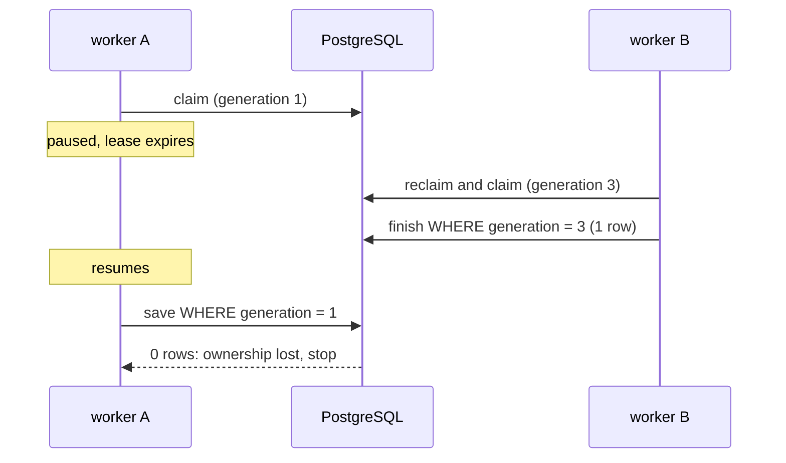

# durable-tasks

[](https://github.com/ymertaliskan0/Durable-Tasks/actions/workflows/ci.yml)

A fault-tolerant distributed task scheduler written in Go, using PostgreSQL
as its only shared state.

Tasks save their progress to the database as they run. When a worker
crashes, another worker resumes the task from its last checkpoint. When a
worker freezes and later wakes up, its writes are rejected, so it cannot
overwrite the work of the worker that took over.

The design is modelled on the task framework (`cloud/tasks`) of Nebius's
open-source [Network Block Store](https://github.com/ydb-platform/nbs). This
project is an independent reimplementation on PostgreSQL. It shares no code
with NBS and is not a contribution to it.

## Getting started

Requirements: Go 1.27+ and Docker.

```bash
make up           # start PostgreSQL in Docker
make migrate      # build bin/durable-tasks and apply the schema
make crash-test   # run the crash test (about 75 seconds)
```

To see a task resume after an interruption, start a worker:

```bash
./bin/durable-tasks worker --lease 3s
```

Then submit a task from a second terminal:

```bash
./bin/durable-tasks submit sleep --steps 20 --step-duration 500ms
./bin/durable-tasks list
```

## Features

- Concurrent task claiming with `SELECT ... FOR UPDATE SKIP LOCKED`
- Leases with heartbeats, and automatic recovery of tasks from crashed
  workers
- Generation-based fencing that rejects writes from workers that lost a task
- Checkpointed, resumable tasks
- Retries with exponential backoff, and a cleanup step for failed or
  cancelled tasks
- Graceful shutdown and idempotent task submission
- Prometheus metrics and a CLI for submitting and inspecting tasks

## Crash test

A crash test runs in CI on every push. It starts four worker processes,
submits 100 file-copy tasks, and for about a minute randomly kills workers
(`SIGKILL`) or freezes them (`SIGSTOP`) for longer than their lease. When
all tasks have ended, it verifies every copy against its source with
SHA-256.

```
durable-tasks crash test: PASS
  chaos:  47 SIGKILL + 32 SIGSTOP (frozen 5s each) over 1m15.8s
  result: 100/100 finished with verified copies; 68 tasks recovered after an interruption
```

Across 79 injected failures, no task was lost or corrupted, and 68 tasks
were resumed from a checkpoint after an interruption. The test was also run
against deliberately broken builds, a disabled recovery loop and an
off-by-one resume, and it detected both.

**Throughput.** On a laptop (WSL2, PostgreSQL 17 in Docker), the scheduler
processes about 4,000 to 6,000 trivial tasks per second with 64 concurrent
task slots, each with its own database connection. Each task commits three
transactions (claim, checkpoint and finish), and most of the time is spent
waiting for those commits to be flushed to disk. Throughput grows with the
number of connections, because PostgreSQL flushes concurrent commits
together. [docs/design.md](docs/design.md#8-crash-test-nemesis-and-benchmark)
has the measurements.

Stop the worker with Ctrl-C while the task is running. The worker releases
the task with its progress saved. When the worker is started again, the
task continues from the last completed step. `durable-tasks status <id>`
shows a task's status, generation and saved state.

## Design

All state lives in a single `tasks` table. Each row holds the task's
request, its saved state, its status, and the worker that currently owns
it. Workers keep no essential state in memory, so any worker can be
stopped at any time without losing work.

**Claiming.** A worker claims the next due task with a single `UPDATE`
statement that uses `FOR UPDATE SKIP LOCKED`. Concurrent workers therefore
claim different tasks instead of waiting on the same row.

**Leases and recovery.** A claim grants a lease, 30 seconds by default.
While the task runs, a heartbeat renews the lease every third of its
duration, so two missed heartbeats are tolerated. If a worker crashes, its
lease expires. A recovery loop that runs in every worker (the *stalker*)
then returns the task to the queue.

**Fencing.** A worker can also be paused rather than crashed, for example
by a long garbage-collection pause or `SIGSTOP`. Its lease expires and
another worker takes over, while the paused worker still considers the task
its own. To prevent conflicting writes, each task has a *generation*
number that increases whenever ownership changes. Every write includes the
generation the worker claimed the task at, so writes from a stale worker
match no rows and are rejected:



**Cancellation.** A cancel request increments the generation. The worker
running the task is rejected at its next heartbeat and stops. Another
worker then runs the task's cleanup step.

**Errors and retries.** Tasks mark errors as retriable or permanent.
Retriable errors are retried with exponential backoff and jitter, up to a
configurable limit. Permanent errors, and tasks that exhaust their retries,
go through the cleanup step and end with status `failed`.

**Shutdown.** On `SIGINT` or `SIGTERM`, a worker stops claiming tasks and
releases its running tasks at their last checkpoint.

**Implementing a task.** A task implements four methods: `Load`, `Run`,
`Save` and `Cancel`. Long-running tasks divide their work into steps and
save their state after each step. See
[sleeptask](internal/tasks/sleeptask/sleeptask.go) for a minimal example,
and [chunkcopy](internal/tasks/chunkcopy/chunkcopy.go) for the file copy
used in the crash test.

## Relation to NBS

The core ideas follow NBS: checkpointed tasks, generation numbers,
cancellation through a generation increment, and recovery of tasks that
stop making progress. The main difference comes from the database. NBS
uses YDB, whose serializable transactions allow it to read a task, check
its generation and write it back. PostgreSQL's default isolation level
(read committed) does not make that pattern safe, so here each check is
part of the `UPDATE` statement itself. This project also adds explicit
leases, backoff between retries, and a distinct `failed` status.

## Limitations

- A single PostgreSQL instance is both a single point of failure and the
  throughput limit. The system suits tasks that run for seconds or longer,
  not very high volumes of very short tasks.
- A step can be executed more than once if a worker crashes after the step
  but before its checkpoint, so steps must be idempotent. A task's final
  outcome is recorded exactly once.
- Fencing protects the database, not external systems. A paused worker may
  still act on an external system before it detects the loss of ownership.
  The file copy is safe because each chunk always writes the same bytes to
  the same offset.

## Development

- `make test` runs all tests with the race detector. Integration tests
  start PostgreSQL through testcontainers.
- `make bench` runs the throughput benchmark.
- `durable-tasks worker --metrics-addr :9090` serves Prometheus metrics.
- [docs/design.md](docs/design.md) contains the design notes, the complete
  state machine, and a detailed comparison with NBS.

**Tech stack:** Go, PostgreSQL 17, pgx, cobra, Prometheus, testcontainers-go,
Docker, GitHub.
