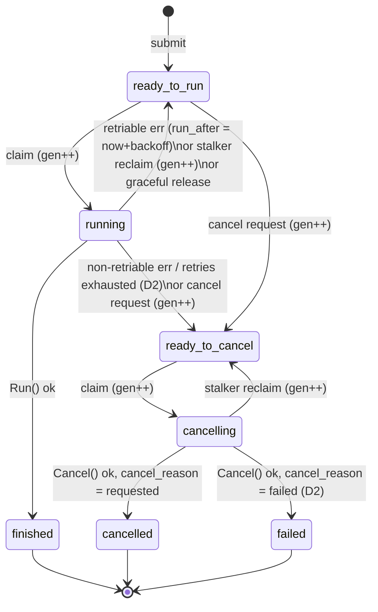

# durable-tasks — design baseline

Status: M1 (scaffold) and M2 (storage) done; M3 (worker + CLI) in progress.
This becomes the source for the README's design sections.

Milestones (revised 2026-11-23 to finish sooner):

1. Scaffold: module, compose, migrations, CLI root. **Done.**
2. Storage: claim, fenced writes, cancel, reclaim, idempotent submit. **Done.**
3. Worker: runner loops, heartbeat, retries with backoff, cleanup path,
   graceful shutdown, stalker loop, and the `worker`/`submit`/`status`/
   `list`/`cancel` commands with the `sleep` demo task.
4. Crash harness and numbers: `nemesis` (SIGKILL/SIGSTOP workers while
   tasks run, then check invariants), Prometheus metrics, `chunkcopy` task,
   benchmark.
5. README: Mermaid diagram, NBS mapping, trade-offs, CV bullet.

durable-tasks is modelled on the task framework in Nebius's Network Block
Store (`cloud/tasks` in ydb-platform/nbs). It is a simplified reimplementation,
not a contribution to it.

---

## 1. Concepts taken from NBS `cloud/tasks`

| NBS concept | Where in NBS | durable-tasks equivalent |
|---|---|---|
| `Task` interface: `Save/Load/Run/Cancel` (+ `GetMetadata/GetResponse`) | `task.go` | `tasks.Task`: the same four methods. Metadata and response are dropped. |
| `RunSteps(startStep, steps, saveState)` | `task.go` | `tasks.RunSteps`, with a `ctx` check between steps |
| `ExecutionContext`: `SaveState`, `GetTaskID`, dependencies, events, hanging estimates … | `execution_context.go` | `TaskID()`, `Generation()`, `SaveState(ctx)` only |
| `TaskState` row with `GenerationID` | `storage/common.go`, `storage/storage.go` | `storage.TaskState`, column `generation` |
| `LockTaskToRun`: read the row, check the generation, `GenerationID++`, set `LastHost/LastRunner` | `storage/storage_ydb_impl.go` | `ClaimNext`: a single `UPDATE … FOR UPDATE SKIP LOCKED` statement |
| `UpdateTask`: fails with `WrongGenerationError` if the generation changed | same | every fenced write uses `WHERE id=$1 AND generation=$2`, and 0 rows means `ErrWrongGeneration` |
| `taskPinger`: pings every `TaskPingPeriod` (2s); on error it calls `cancelRun()` | `runner.go` | heartbeat goroutine every `lease/3`, which calls `cancel(cause)` |
| "Stalling" tasks: `modified_at < now - TaskStallingTimeout` (10s), picked up by *stalking runners* | `runner.go`, `ListTasksStallingWhileRunning` | explicit `lease_expires_at` + `Stalker` loop |
| `MarkForCancellation`: status becomes `ready_to_cancel` **and `GenerationID++`** | `storage_ydb_impl.go` | the same. Cancellation reuses fencing (see §5). |
| Separate run and cancel runner pools | `runnerForRun`, `runnerForCancel` | one runner that dispatches on the claimed status |
| Error taxonomy: `RetriableError`, `NonRetriableError`, `AbortedError`, `NonCancellableError`, `WrongGenerationError`, `InterruptExecutionError`, `PanicError` | `errors/errors.go` | `RetriableError` and `NonRetriableError`, plus `storage.ErrWrongGeneration`. Panics are recovered into retriable errors. |
| `MaxRetriableErrorCount` (100) | `config/config.proto` | `--max-retries` |
| Idempotency key on `CreateTask` | `storage.go` | `UNIQUE` nullable column + `ON CONFLICT DO NOTHING` |
| `nemesis`: restarts a command at random intervals | `test/nemesis/main.go` | `durable-tasks nemesis`: `SIGKILL`/`SIGSTOP` against docker-compose workers, plus a checker |
| Out of scope | | task dependencies, regular (cron) tasks, events, zones, non-cancellable tasks, hanging-task detection, tracing, S3 persistence, node heartbeats |

### Where NBS behaves differently from the spec, and what we pick

1. **NBS has no explicit lease.** Liveness is inferred from `modified_at`,
   which every ping and save updates. We store `lease_owner` and
   `lease_expires_at` explicitly because they are easier to explain and
   inspect.
2. **NBS claims in two phases.** A lister reads candidate IDs from a snapshot,
   shuffles them to reduce contention, then each runner does an optimistic
   compare-and-set on the generation. Postgres's `FOR UPDATE SKIP LOCKED` lets
   us claim in one statement with no contention. Both are valid, and the
   contrast makes a good interview answer.
3. **NBS has no `failed` status.** A non-retriable error sets the error fields
   and moves the task to `ready_to_cancel`, so `Cancel()` runs to undo partial
   work, and the task ends as `cancelled` with an error. (Decision D2 below.)
4. **NBS retries without backoff.** A retriable error increments
   `retriable_error_count`, and the runner walks away from the task while it
   is still `running`. The task stalls, and a stalking runner picks it up
   later, so the stalling timeout acts as the backoff. We add a `run_after`
   column for real exponential backoff with jitter. (Decision D3 below.)
5. **NBS has no clock skew.** All times are compared in the DB. We do the
   same: only `now()` in SQL, never `time.Now()` from a worker, for anything
   that affects leases.

---

## 2. Package layout and dependency direction

```
cmd/durable-tasks         main(): builds the cobra root and calls Execute
internal/cli              one file per subcommand (worker, submit, status, list, cancel, migrate, nemesis)
internal/storage          Postgres access: TaskState, Status, sentinel errors, migrations (embed)
internal/tasks            Task, ExecutionContext, RunSteps, errors, Registry, Worker (runner, heartbeat, stalker), backoff
internal/tasks/chunkcopy  ChunkedCopy task   (not "copy": that would shadow the builtin copy())
internal/tasks/sleeptask  SleepTask for benchmarks
internal/metrics          Prometheus collectors on a private registry, plus the /metrics handler
internal/nemesis          crash harness + checker + report  (M5)
```

Imports only point down. `storage` imports nothing from `tasks`. Example tasks
import `tasks`, and `cli` wires everything together. Go rejects import cycles
at compile time, so this direction is enforced, not just a convention.

**Go idiom: consumer-defined interfaces.** In Java, `PostgresTaskStore` would
usually implement a `TaskStore` interface that lives next to it. In Go,
`storage` exports a concrete `*storage.Postgres`, and `tasks` declares the
small interface it needs (`type Store interface { ClaimNext…; Heartbeat…; … }`).
Go interfaces are satisfied implicitly, so `storage` never mentions them, and
unit tests can pass a hand-written fake without a mocking library.
("Accept interfaces, return structs.")

---

## 3. Core types (sketches; final signatures may change slightly)

### `internal/storage`

```go
type Status string

const (
    StatusReadyToRun    Status = "ready_to_run"
    StatusRunning       Status = "running"
    StatusFinished      Status = "finished"
    StatusFailed        Status = "failed"
    StatusReadyToCancel Status = "ready_to_cancel"
    StatusCancelling    Status = "cancelling"
    StatusCancelled     Status = "cancelled"
)

type TaskState struct {
    ID                  uuid.UUID // UUIDv7: time-ordered, keeps the PK B-tree append-mostly
    Type                string
    Request, State      []byte    // opaque to the framework (JSON from the task)
    Status              Status
    Generation          int64
    RetriableErrorCount int
    LastError           string
    CancelReason        CancelReason // "requested" | "failed", set on the cancel path (migration 0002)
    IdempotencyKey      string    // "" = none (SQL NULL)
    LeaseOwner          string
    LeaseExpiresAt      time.Time // zero if not leased
    RunAfter            time.Time
    CreatedAt, ModifiedAt time.Time
}

var (
    ErrNotFound        = errors.New("task not found")
    ErrNoTask          = errors.New("no claimable task")
    ErrWrongGeneration = errors.New("wrong generation: task was reclaimed or cancelled")
    ErrIdempotencyConflict = errors.New("idempotency key reused with a different task")
    ErrAlreadyEnded    = errors.New("task already ended") // RequestCancel on finished/failed
)

type Postgres struct{ pool *pgxpool.Pool }

func Open(ctx context.Context, dsn string) (*Postgres, error)
func (p *Postgres) Close()
func (p *Postgres) Migrate(ctx context.Context) error                 // M1

// Submission and inspection (M2/M4)
func (p *Postgres) CreateTask(ctx, NewTask) (id uuid.UUID, created bool, err error)
func (p *Postgres) GetTask(ctx, id uuid.UUID) (TaskState, error)
func (p *Postgres) ListTasks(ctx, status Status, limit int) ([]TaskState, error) // status "" = all
func (p *Postgres) RequestCancel(ctx, id uuid.UUID) error             // generation++

// Execution, all fenced on (id, generation) except ClaimNext/ReclaimExpired (M2)
func (p *Postgres) ClaimNext(ctx, owner string, lease time.Duration) (TaskState, error)
func (p *Postgres) Heartbeat(ctx, id, gen, lease) error
func (p *Postgres) SaveState(ctx, id, gen, state []byte) error
func (p *Postgres) Finish(ctx, id, gen, state []byte) error
func (p *Postgres) ScheduleRetry(ctx, id, gen, state []byte, lastErr string, delay time.Duration) error
func (p *Postgres) Fail(ctx, id, gen, state []byte, lastErr string) error // → ready_to_cancel, cancel_reason=failed (D2)
func (p *Postgres) MarkCancelled(ctx, id, gen) error                  // → cancelled or failed, by cancel_reason
func (p *Postgres) Release(ctx, id, gen) error                        // graceful shutdown; generation++
func (p *Postgres) ReclaimExpired(ctx, limit int) (int, error)        // stalker
func (p *Postgres) CountByStatus(ctx) (map[Status]int, error)         // queue-depth gauge
```

### `internal/tasks`

```go
type Task interface {
    Save() ([]byte, error)
    Load(request, state []byte) error
    Run(ctx context.Context, exec ExecutionContext) error
    Cancel(ctx context.Context, exec ExecutionContext) error
}

type ExecutionContext interface {
    TaskID() uuid.UUID
    Generation() int64
    SaveState(ctx context.Context) error // calls task.Save(), then a fenced write
}

type Step func(ctx context.Context) error

// Runs steps[start:]. After each step it calls saveState(ctx, i+1), and it
// stops early if ctx is done.
func RunSteps(ctx context.Context, start int, steps []Step,
    saveState func(ctx context.Context, next int) error) error

type Factory func() Task
type Registry struct{ /* map[string]Factory */ }
func (r *Registry) Register(taskType string, f Factory)

type RetriableError struct{ Err error }    // Error() + Unwrap()
type NonRetriableError struct{ Err error }
func Retriable(err error) error
func NonRetriable(err error) error
// Classification uses errors.As/errors.Is. Unclassified errors count as
// non-retriable (as in NBS: fail loudly unless the task opts in to retries).

type Config struct {
    WorkerID        string
    Concurrency     int
    Lease           time.Duration // heartbeat every Lease/3
    PollInterval    time.Duration // idle back-off when the queue is empty
    StalkerInterval time.Duration
    MaxRetries      int
    BackoffBase, BackoffMax time.Duration
    ShutdownGrace   time.Duration
}

type Worker struct{ /* store Store; registry; cfg; metrics; log *slog.Logger */ }
func NewWorker(store Store, reg *Registry, cfg Config, log *slog.Logger) (*Worker, error) // metrics added in M4
func (w *Worker) Run(ctx context.Context) error // blocks; returns after a clean drain
```

After each execution the worker builds an `execution` summary (cleanup?,
error, lost ownership?, shutting down?, retries so far) and a pure function
`decide` maps it to one outcome: abandon, finish, cancelled, retry, fail or
release. Keeping the decision pure makes every branch table-testable.

Concurrency shape inside `Worker.Run`: `Concurrency` runner goroutines (each
loops claim → execute) plus one stalker goroutine, all tracked with
`sync.WaitGroup.Go` (Go 1.25+). Each claimed task runs under
`context.WithCancelCause`, so the heartbeat can cancel it *with a reason*
(`ErrWrongGeneration`, `ErrCancelRequested`, lease lost), and the runner reads
that reason with `context.Cause(ctx)`.

### `internal/tasks/chunkcopy`

```go
type Request struct{ Src, Dst string; ChunkSize int64 } // default 4 MiB
type State   struct{ NextChunk int; ChunkCRC32C []uint32; Verified bool }
```

Steps: `ceil(size/chunk)` copy steps (`ReadAt` + `WriteAt`, CRC32C per chunk),
then one verify step (SHA-256 of `src` vs `dst`). `Cancel()` removes `Dst`.

---

## 4. Schema (migration `0001_create_tasks.sql`)

```sql
CREATE TABLE tasks (
    id                    uuid PRIMARY KEY,
    task_type             text        NOT NULL,
    request               bytea       NOT NULL,
    state                 bytea,
    status                text        NOT NULL CHECK (status IN (
        'ready_to_run','running','finished','failed',
        'ready_to_cancel','cancelling','cancelled')),
    generation            bigint      NOT NULL DEFAULT 0,
    retriable_error_count integer     NOT NULL DEFAULT 0,
    last_error            text,
    idempotency_key       text        UNIQUE,          -- NULLs never conflict
    lease_owner           text,
    lease_expires_at      timestamptz,
    run_after             timestamptz NOT NULL DEFAULT now(),
    created_at            timestamptz NOT NULL DEFAULT now(),
    modified_at           timestamptz NOT NULL DEFAULT now(),
    -- Invariant: a task holds a lease iff it is in flight.
    CONSTRAINT lease_iff_inflight CHECK (
        (status IN ('running','cancelling'))
        = (lease_owner IS NOT NULL AND lease_expires_at IS NOT NULL))
);

-- Claim path: only claimable rows, ordered by run_after.
CREATE INDEX tasks_claimable ON tasks (run_after)
    WHERE status IN ('ready_to_run','ready_to_cancel');
-- Stalker path: only in-flight rows, ordered by expiry.
CREATE INDEX tasks_inflight ON tasks (lease_expires_at)
    WHERE status IN ('running','cancelling');
```

Migration `0002_add_cancel_reason.sql` adds `cancel_reason` (`requested` | `failed`), which is required while a task is on the cancel path. `last_error` cannot play this role, because retries also set it.

`status` is `text` with a `CHECK` constraint rather than a Postgres `ENUM`,
because enum values are awkward to change in later migrations.

Migrations are applied by a small migrator of about 60 lines. It reads
`migrations/*.sql` from an `embed.FS` and records each applied file in
`schema_migrations`. The whole run holds `pg_advisory_xact_lock`, so five
workers starting at once cannot race to migrate.

---

## 5. State machine



**Why `RequestCancel` bumps the generation (taken from NBS):** the running
worker does not need a separate cancellation channel. Its next heartbeat or
`SaveState` matches 0 rows, so it abandons the task just as it would after a
reclaim. One fencing mechanism covers both reclaims and cancellation. A cheap
`SELECT status` after a 0-row update tells the two cases apart, so metrics
and logs can report them separately.

---

## 6. Dependencies

| Dependency | Why |
|---|---|
| Go **1.27.x** (latest stable is 1.27.4) | `WaitGroup.Go`, `context.WithCancelCause`, `testing.T.Context`, `math/rand/v2` |
| `github.com/jackc/pgx/v5` (+ `pgxpool`) | Postgres driver and connection pool |
| `github.com/google/uuid` | `uuid.NewV7()` |
| `github.com/spf13/cobra` | CLI |
| `github.com/prometheus/client_golang` | metrics |
| `github.com/testcontainers/testcontainers-go` (+ `modules/postgres`) | real Postgres in tests |
| stdlib | `log/slog`, `embed`, `os/signal`, `encoding/json`, `hash/crc32`, `crypto/sha256`, `testing` |
| Docker: `postgres:17-alpine` | local and compose. (17 instead of 18 avoids 18's changed `PGDATA` volume layout.) |
| CI: `actions/setup-go`, `golangci/golangci-lint-action` | lint + `go test -race ./...` |

**Deliberately not used:** golang-migrate (we write our own migrator), errgroup
(`WaitGroup.Go` is enough), testify and gomock (stdlib `testing` and
hand-written fakes), viper (flags are enough).

---

## 7. Fencing and the file system (to be expanded in M3)

Fencing protects **DB state**: a stale worker's `SaveState` or `Finish` matches
0 rows. It cannot protect **file writes**. A zombie that wakes up after
`SIGCONT` can still `WriteAt` into `Dst` before its next DB call fails. This is
acceptable here because every write is *positional and deterministic*: chunk
*i* always writes the same bytes from `Src` at offset `i*chunk`. A late
duplicate write therefore produces the same bytes that are already there, and
the final verify step checks the whole file. A real system would add a fencing
token to the storage layer itself, which is the idea Kleppmann calls fencing
tokens. (TODO before writing the README: check whether NBS's dataplane
`FillGeneration` / `FillSeqNumber` on disks plays this role. It is outside the
sparse checkout.)
