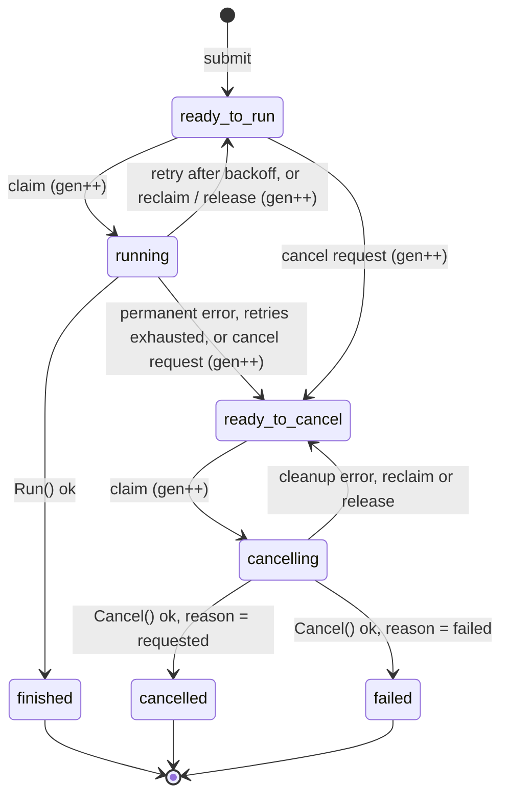

# durable-tasks: design notes

These notes explain how durable-tasks works and why I made the choices I
did. The [README](../README.md) gives a shorter overview.

durable-tasks is modelled on the task framework in Nebius's Network Block
Store (`cloud/tasks` in [ydb-platform/nbs](https://github.com/ydb-platform/nbs)).
It is a simplified, independent reimplementation on PostgreSQL. It shares
no code with NBS and is not a contribution to it.

---

## 1. Concepts taken from NBS `cloud/tasks`

| NBS concept | Where in NBS | durable-tasks equivalent |
|---|---|---|
| `Task` interface: `Save/Load/Run/Cancel` (+ `GetMetadata/GetResponse`) | `task.go` | `tasks.Task`: the same four methods. Metadata and response are dropped. |
| `RunSteps(startStep, steps, saveState)` | `task.go` | `tasks.RunSteps`, with a `ctx` check between steps |
| `ExecutionContext`: `SaveState`, `GetTaskID`, dependencies, events, hanging estimates … | `execution_context.go` | `TaskID()`, `Generation()`, `SaveState(ctx)` only |
| `TaskState` row with `GenerationID` | `storage/common.go`, `storage/storage.go` | `storage.TaskState`, column `generation` |
| `LockTaskToRun`: read the row, check the generation, `GenerationID++`, set `LastHost/LastRunner` | `storage/storage_ydb_impl.go` | `ClaimNext`: a single `UPDATE … FOR UPDATE SKIP LOCKED` statement |
| `UpdateTask`: fails with `WrongGenerationError` if the generation changed | same | every fenced write uses `WHERE id=$1 AND generation=$2`, and 0 rows means `ErrWrongGeneration` |
| `taskPinger`: pings every `TaskPingPeriod`; on error it calls `cancelRun()` | `runner.go` | a heartbeat goroutine every `lease/3`, which cancels the task's context with a cause |
| "Stalling" tasks: `modified_at` older than `TaskStallingTimeout`, picked up by *stalking runners* | `runner.go`, `ListTasksStallingWhileRunning` | an explicit `lease_expires_at`, and a stalker loop in every worker |
| `MarkForCancellation`: status becomes `ready_to_cancel` **and `GenerationID++`** | `storage_ydb_impl.go` | the same. Cancellation reuses fencing (see §5). |
| Separate run and cancel runner pools | `runnerForRun`, `runnerForCancel` | one runner that dispatches on the claimed status |
| Error taxonomy: `RetriableError`, `NonRetriableError`, `AbortedError`, `NonCancellableError`, `WrongGenerationError`, `InterruptExecutionError`, `PanicError` | `errors/errors.go` | `RetriableError` and `NonRetriableError`, plus `storage.ErrWrongGeneration`. Panics are recovered as retriable errors. |
| `MaxRetriableErrorCount` | `config/config.proto` | `--max-retries` |
| Idempotency key on `CreateTask` | `storage.go` | a `UNIQUE` nullable column + `ON CONFLICT DO NOTHING` |
| `nemesis`: restarts a command at random intervals | `test/nemesis/main.go` | `durable-tasks nemesis`: `SIGKILL`/`SIGSTOP` against local worker processes, plus an invariant checker (§8) |
| Out of scope | | task dependencies, regular (cron) tasks, events, zones, non-cancellable tasks, hanging-task detection, tracing, S3 persistence, node heartbeats |

### Where I deviated from NBS, and why

1. **Explicit leases.** NBS has no explicit lease: liveness is inferred from
   `modified_at`, which every ping and save updates. I store `lease_owner`
   and `lease_expires_at` explicitly, because they are easier to reason
   about and to inspect.
2. **One-statement claims.** NBS claims in two phases. A lister reads
   candidate IDs from a snapshot and shuffles them to reduce contention,
   then each runner does an optimistic compare-and-set on the generation.
   PostgreSQL's `FOR UPDATE SKIP LOCKED` lets me claim in a single statement
   without that contention. Both approaches are valid.
3. **A `failed` status.** In NBS, a non-retriable error moves the task to
   `ready_to_cancel`, so `Cancel()` undoes partial work, and the task ends as
   `cancelled` with an error. I keep the cleanup path but end such tasks as
   `failed`, so they can be told apart from user cancellations. A
   `cancel_reason` column (`requested` or `failed`) records why a task is on
   the cancel path. `last_error` cannot serve this purpose, because retries
   also set it.
4. **Backoff between retries.** In NBS, a retriable error increments
   `retriable_error_count` and the runner walks away from the task while it
   is still `running`. The task stalls until a stalking runner picks it up,
   so the stalling timeout acts as the backoff. I added a `run_after` column
   for exponential backoff with jitter.
5. **The database clock only.** Like NBS, I compare all times in the
   database: only `now()` in SQL, never `time.Now()` from a worker, for
   anything that affects leases. Clock skew between workers therefore does
   not matter.

---

## 2. Package layout and dependency direction

```
cmd/durable-tasks         main(): runs the CLI
internal/cli              one file per command group: migrate, worker, submit, status/list/cancel, nemesis/bench
internal/storage          PostgreSQL access: TaskState, Status, sentinel errors, embedded migrations
internal/tasks            Task, ExecutionContext, RunSteps, errors, Registry, Worker (runners, heartbeat, stalker), backoff
internal/tasks/chunkcopy  chunked, checkpointed file copy (not "copy", which would shadow the builtin)
internal/tasks/sleeptask  demo task, also used by the benchmark
internal/metrics          Prometheus metrics on a private registry, collected by wrapping the store
internal/nemesis          crash-test harness, invariant checker and benchmark
internal/pgtest           test helper: one Postgres container per test binary, one database per test
```

Imports only point down. `storage` imports nothing from `tasks`. Example
tasks import `tasks`, and `cli` wires everything together. Go rejects import
cycles at compile time, so this direction is enforced, not just a
convention.

**Consumer-defined interfaces.** `storage` exports the concrete type
`*storage.Postgres`. The `tasks` package declares the small `Store`
interface it needs, and `*storage.Postgres` satisfies it implicitly. That
makes the store easy to wrap. The metrics package and the test spies embed
`Store` and override only the methods they observe.

---

## 3. Core types

### `internal/storage`

```go
type Status string // ready_to_run, running, finished, failed, ready_to_cancel, cancelling, cancelled

type TaskState struct {
    ID                  uuid.UUID // UUIDv7: time-ordered, keeps the primary-key B-tree append-mostly
    Type                string
    Request, State      []byte    // opaque to the framework (JSON from the task)
    Status              Status
    Generation          int64     // fencing token
    RetriableErrorCount int
    LastError           string
    CancelReason        CancelReason // "requested" | "failed", set on the cancel path
    IdempotencyKey      string    // "" = none (SQL NULL)
    LeaseOwner          string
    LeaseExpiresAt      time.Time // zero if not leased
    RunAfter            time.Time
    CreatedAt, ModifiedAt time.Time
}

var (
    ErrNotFound, ErrNoTask, ErrWrongGeneration, ErrIdempotencyConflict, ErrAlreadyEnded error
)

func Open(ctx context.Context, dsn string) (*Postgres, error)
func (p *Postgres) Migrate(ctx context.Context) error

// Submission and inspection
func (p *Postgres) CreateTask(ctx, NewTask) (id uuid.UUID, created bool, err error)
func (p *Postgres) GetTask(ctx, id) (TaskState, error)
func (p *Postgres) ListTasks(ctx, status Status, limit int) ([]TaskState, error) // status "" = all
func (p *Postgres) CountByStatus(ctx) (map[Status]int, error)
func (p *Postgres) RequestCancel(ctx, id) error // generation++

// Execution. Everything except ClaimNext and ReclaimExpired is fenced on (id, generation).
func (p *Postgres) ClaimNext(ctx, owner string, lease time.Duration) (TaskState, error)
func (p *Postgres) Heartbeat(ctx, id, gen, lease) error
func (p *Postgres) SaveState(ctx, id, gen, state []byte) error
func (p *Postgres) Finish(ctx, id, gen, state []byte) error
func (p *Postgres) ScheduleRetry(ctx, id, gen, state []byte, lastErr string, delay time.Duration) error
func (p *Postgres) Fail(ctx, id, gen, state []byte, lastErr string) error // → ready_to_cancel, cancel_reason = failed
func (p *Postgres) MarkCancelled(ctx, id, gen) error                     // → cancelled or failed, by cancel_reason
func (p *Postgres) Release(ctx, id, gen) error                           // graceful shutdown; generation++
func (p *Postgres) ReclaimExpired(ctx, limit int) (int, error)           // stalker; generation++
```

### `internal/tasks`

```go
type Task interface {
    Save() ([]byte, error)
    Load(request, state []byte) error
    Run(ctx context.Context, exec ExecutionContext) error
    Cancel(ctx context.Context, exec ExecutionContext) error
}

type ExecutionContext interface {
    TaskID() uuid.UUID
    Generation() int64
    SaveState(ctx context.Context) error // calls task.Save(), then a fenced write
}

// Runs steps[start:]. After each step it calls saveState(ctx, i+1); it stops
// early if ctx is done.
func RunSteps(ctx context.Context, start int, steps []Step,
    saveState func(ctx context.Context, next int) error) error

func NewRegistry() *Registry
func (r *Registry) Register(taskType string, f Factory)
func (r *Registry) New(taskType string) (Task, error)

func Retriable(err error) error
func NonRetriable(err error) error
func IsRetriable(err error) bool
func IsNonRetriable(err error) bool

func NewWorker(store Store, reg *Registry, cfg Config, log *slog.Logger) (*Worker, error)
func (w *Worker) Run(ctx context.Context) error // blocks; returns after a clean shutdown
```

Unmarked errors count as permanent: a task opts in to retries by wrapping
an error with `Retriable`. If an error is marked both ways, `NonRetriable`
wins.

**Inside `Worker.Run`.** `Concurrency` runner goroutines each loop: claim a
task, execute it, write the outcome. One stalker goroutine reclaims expired
leases. All of them are tracked with `sync.WaitGroup.Go`, so `Run` returns
only after every task has been released.

**Executing one task.** Each claimed task runs under its own
`context.WithCancelCause`. A heartbeat goroutine extends the lease every
`lease/3`. If a heartbeat is rejected, it cancels the task's context with
`ErrWrongGeneration` as the cause, and the runner reads that cause with
`context.Cause`.

**Deciding the outcome.** After each execution, the worker builds a
summary: was this a cleanup, the error, whether ownership was lost, whether
the worker is shutting down, and the retries so far. A pure function,
`decide`, maps that summary to one outcome: abandon, finish, cancelled,
retry, fail or release. The rules are checked in order:

1. Ownership was lost: abandon, and write nothing.
2. The work succeeded: finish, or end the cleanup. This applies even
   during shutdown, so completed work is never redone.
3. The worker is shutting down: release.
4. A cleanup failed: retry it, without a limit, unless the error is
   `NonRetriable`.
5. A retriable error with retries left: retry with backoff.
6. Otherwise: fail.

Keeping the decision pure lets one table-driven test cover every branch.
The outcome is written with a context detached from the worker's
(`context.WithoutCancel`, bounded by a timeout), so a task can still be
released while the worker shuts down.

### `internal/tasks/chunkcopy`

```go
type Request struct {
    Src, Dst   string        // absolute paths
    ChunkSize  int64         // default 4 MiB
    ChunkDelay time.Duration // optional pause per chunk, for demos and the crash test
}
type State struct {
    Size      int64 // size of Src, recorded on the first execution
    Started   bool  // Dst has been created and truncated to Size
    NextChunk int   // first chunk not yet copied
}
```

The first execution records the source size and creates `Dst` at that size.
Then there is one step per chunk: a `ReadAt` + `WriteAt` at the same offset,
followed by `fsync`, so a checkpoint never claims more than is durably
written. A final step compares SHA-256 hashes of `Src` and `Dst`. A
mismatch is a permanent error. `Cancel()` removes `Dst`.

---

## 4. Schema

```sql
CREATE TABLE tasks (
    id                    uuid PRIMARY KEY,
    task_type             text        NOT NULL,
    request               bytea       NOT NULL,
    state                 bytea,
    status                text        NOT NULL CHECK (status IN (
        'ready_to_run','running','finished','failed',
        'ready_to_cancel','cancelling','cancelled')),
    generation            bigint      NOT NULL DEFAULT 0,
    retriable_error_count integer     NOT NULL DEFAULT 0,
    last_error            text,
    idempotency_key       text        UNIQUE,          -- NULLs never conflict
    lease_owner           text,
    lease_expires_at      timestamptz,
    run_after             timestamptz NOT NULL DEFAULT now(),
    created_at            timestamptz NOT NULL DEFAULT now(),
    modified_at           timestamptz NOT NULL DEFAULT now(),
    -- Invariant: a task holds a lease iff it is in flight.
    CONSTRAINT lease_iff_inflight CHECK (
        (status IN ('running','cancelling'))
        = (lease_owner IS NOT NULL AND lease_expires_at IS NOT NULL))
);

-- Claim path: only claimable rows, ordered by run_after.
CREATE INDEX tasks_claimable ON tasks (run_after)
    WHERE status IN ('ready_to_run','ready_to_cancel');
-- Stalker path: only in-flight rows, ordered by expiry.
CREATE INDEX tasks_inflight ON tasks (lease_expires_at)
    WHERE status IN ('running','cancelling');
```

Migration `0002_add_cancel_reason.sql` adds `cancel_reason` (`requested` |
`failed`), with a check that every task on the cancel path has one.

I used `text` with a `CHECK` constraint for `status` rather than a Postgres
`ENUM`, because enum values are awkward to change in later migrations. The
constraints are a safety net: whatever bug the Go code has, an impossible
row, such as a finished task that still holds a lease, is rejected by the
database.

Migrations are applied by a small migrator. It reads `migrations/*.sql`
from an `embed.FS` and records each applied file in `schema_migrations`.
The whole run holds `pg_advisory_xact_lock`, because
`CREATE TABLE IF NOT EXISTS` is not safe to run concurrently. Several
workers starting at once therefore cannot race to migrate.

---

## 5. State machine



**Why `RequestCancel` increments the generation (taken from NBS).** The
running worker does not need a separate cancellation channel. Its next
heartbeat or `SaveState` matches 0 rows, so it abandons the task just as it
would after a reclaim. A worker then claims the task from `ready_to_cancel`
and runs `Cancel()`. One fencing mechanism covers reclaims, releases and
cancellation.

**Why fenced writes also check the status.** `Finish` does not change the
generation. Without a status check, a heartbeat that arrived just after
`Finish` would match the row and give a finished task a new lease. Every
fenced write therefore also requires the statuses it is valid in, for
example `status IN ('running','cancelling')`.

---

## 6. Dependencies

| Dependency | Why |
|---|---|
| Go 1.27 | `sync.WaitGroup.Go`, `context.WithCancelCause`, `context.WithoutCancel`, `testing.T.Context`, `math/rand/v2` |
| `github.com/jackc/pgx/v5` (+ `pgxpool`) | Postgres driver and connection pool |
| `github.com/google/uuid` | `uuid.NewV7()` |
| `github.com/spf13/cobra` | CLI |
| `github.com/prometheus/client_golang` | metrics |
| `github.com/testcontainers/testcontainers-go` (+ `modules/postgres`) | a real Postgres in tests |
| standard library | `log/slog`, `embed`, `os/signal`, `os/exec`, `encoding/json`, `crypto/sha256`, `testing` |
| Docker: `postgres:17-alpine` | local development, tests and CI |
| CI: GitHub Actions, `golangci-lint` | lint, `go test -race ./...`, and the crash test |

**Deliberately not used:**
- golang-migrate: a small custom migrator is enough.
- errgroup: `WaitGroup.Go` covers it.
- testify and gomock: the standard `testing` package and hand-written fakes suffice.
- viper: command-line flags are enough.

---

## 7. Fencing and the file system

Fencing protects **database state**: a stale worker's `SaveState` or
`Finish` matches 0 rows. It cannot protect **file writes**. A paused worker
that wakes up after `SIGCONT` can still `WriteAt` into `Dst` before its
next database call fails.

I accepted this for `chunkcopy` because every write is *positional and
deterministic*: chunk *i* always writes the same bytes from `Src` at offset
`i*chunk`. A late duplicate write therefore produces bytes that are already
there, and the final verify step checks the whole file. A general system
would need the external resource itself to check a fencing token, which is
the idea Kleppmann describes as fencing tokens.

---

## 8. Crash test (`nemesis`) and benchmark

`durable-tasks nemesis` (or `make crash-test`) runs a crash test in a fresh
scratch database:

1. It writes N random source files and submits one `chunkcopy` task per
   file.
2. It starts W `durable-tasks worker` *processes*, with 2 task slots each.
3. **Chaos phase.** About every 750 ms, it picks a random worker and
   either SIGKILLs it (and starts a replacement) or SIGSTOPs it for longer
   than the lease. A stopped worker therefore wakes up as a zombie whose
   task has been reclaimed.
4. It waits for every task to end, stops the workers with SIGTERM, and
   checks the invariants:
   - every task is `finished`
   - no lease is left behind
   - every destination is byte-identical to its source (SHA-256)

**What it proves.** Liveness: the tasks of crashed and frozen workers are
always recovered by the stalker. Integrity: resuming from checkpoints never
skips or corrupts data.

**What it does not prove by itself.** It cannot show that two owners never
run a task at the same time, because deterministic positional writes make
that invisible in the files (see §7). Fencing is verified instead by
`TestWorker_FencesOutZombie`, which counts the zombie's write attempts.

I checked the harness against deliberately broken builds. With the stalker
disabled, it reports tasks stuck in `running`. With an off-by-one resume,
it reports corrupted copies.

### Benchmark

`durable-tasks bench` (or `make bench`) measures the scheduler's own
overhead with tasks that do no work. Each task commits three transactions:
claim, checkpoint and finish. By default it runs 8 in-process workers with
8 slots each, and gives the connection pool one connection per slot plus
one per worker for its stalker.

Measured on a laptop (20 threads, WSL2, PostgreSQL 17 in Docker). Each value
is the median of three runs of 8,000 tasks:

| Task slots | Default pool (20 connections) | One connection per slot | p50 claim-to-finish |
|---|---|---|---|
| 8 | 635 tasks/s | 632 tasks/s | 8.3 ms |
| 16 | 1,242 | 1,247 | 8.4 ms |
| 32 | 1,518 | 2,370 | 8.8 ms |
| 64 | 1,428 | 4,039 | 9.3 ms |

**What limits throughput.** I sampled `pg_stat_activity` every 50 ms during
the 64-slot runs:

- **Waiting for commits to be flushed to disk.** About 50–65% of
  connection time was spent waiting for the write-ahead log to be flushed
  (`LWLock:WALWrite`, `IO:WalSync`). Lock waits took about 15%.
- **Per-task latency stays flat.** With one connection per slot, latency
  holds at 8–9 ms while throughput grows almost in proportion to the
  number of slots. PostgreSQL's group commit lets concurrent transactions
  share one flush, so more connections means more tasks per flush.
- **pgxpool's default size.** It defaults to one connection per CPU thread
  (20 here). With more slots than connections, the extra slots wait for a
  free connection in the Go process: throughput flattens around 1,500
  tasks/s and latency rises. This is why `bench` sizes the pool itself.

**With flushing turned off.** I also ran the benchmark with
`synchronous_commit=off`, which removes the flush wait. Throughput reached
about 7,000 tasks/s at 32 slots and did not increase at 64. About half of
the connection time then went to lock waits: `LWLock:BufferContent` and
`Lock:transactionid`. Every claimer competes for the same pages at the
head of the queue. That is the next limit after commit latency, and
claiming several tasks per statement would be the way past it.

**Measurement caveats.**

- Results vary by up to 2× between runs with durable commits, because
  flush latency on WSL2's virtual disk varies. Runs with flushing turned
  off varied by about ±5%.
- Back-to-back runs were often slower than the first one, so I compare
  medians of repeated runs rather than single runs.
- The benchmark and PostgreSQL share the same 20 threads.
